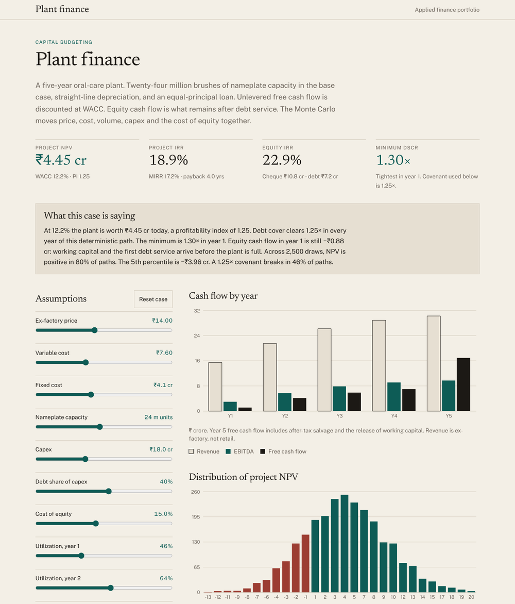

# Plant finance

Capital budgeting for a five-year toothbrush plant: NPV, IRR, MIRR, payback, debt service cover and a 2,500-path Monte Carlo, computed live in the browser. Move an assumption and every figure, chart and sentence on the page recomputes.



**Live:** https://tanmayvasvani.github.io/plant-finance/ · **Author:** Tanmay Vaswani

## What it does

The base case is a plant with 24 million brushes of nameplate capacity, ₹18 crore of capex funded 40% with a five-year equal-principal loan, ramping from 46% to 90% utilisation. The page reports, for whatever case is on screen:

- **Project NPV** at WACC, with the profitability index, project IRR and MIRR, simple and discounted payback.
- **Equity IRR** from the cash flow left after debt service, and the sponsor's cheque at t0.
- **Minimum DSCR** against a 1.25× covenant, with the tightest year named.
- **A Monte Carlo** that shocks price, variable cost, capex, volume and the cost of equity together (price and volume are negatively correlated), reporting the NPV distribution, P(NPV > 0) and how often the covenant breaks.
- **A tornado** of which input moves NPV most.
- **A year-by-year table** of revenue, EBITDA, depreciation, interest, cash tax, working capital, unlevered and equity cash flow, and DSCR.

Base case: NPV ₹4.45 crore at a 12.2% WACC, project IRR 18.9%, equity IRR 22.9%, minimum DSCR 1.30× in year 1, NPV positive in 80% of simulated paths.

## Method

- Revenue and variable cost scale with utilisation; fixed cost does not. Depreciation is straight line and stops at zero book value.
- Unlevered tax is charged on EBIT with a loss carry-forward and no interest deduction; the interest tax shield lives in WACC, not in the cash flows. Levered tax (for equity cash flow) does deduct interest.
- WACC uses the target debt share of capex as the weight, so it is a target structure rather than a market-value weight that updates each year.
- Working capital is a share of the year's revenue and is released in full in year 5. Salvage is a share of original capex, taxed on the gain over remaining book value.
- DSCR is (EBITDA − cash tax) / (interest + principal), algebraically the (PAT + depreciation + interest) / debt service ratio Indian term lenders quote. It does not net off the working-capital build, which is why year 1 can clear the covenant while equity cash flow is still negative. A stricter CFADS definition would put year-1 cover well under 1×.
- Monte Carlo shocks are median-preserving lognormals for price, cost and capex (so the base case is the median path), an arithmetic volume shock correlated with price and capped at nameplate, and a level shock to the cost of equity. The seed is fixed, so results are reproducible.

## Checks

`npm test` runs 35 assertions, including: the IRR zeroes the unlevered NPV; PI equals 1 + NPV/capex; the loan is fully repaid and working capital fully released; with no debt, equity cash flow equals project cash flow and the two IRRs coincide; DSCR matches the PAT + depreciation + interest form; the simulation is reproducible from its seed and collapses onto the base case when every shock is switched off; the tornado is sorted with price at the top; and the normal CDF matches double-precision reference values to 12 digits.

## Run it locally

```bash
npm install
npm run dev        # http://localhost:5173
npm test           # vitest
npm run build      # typecheck + static build into dist/
```

Requires Node 20 or newer.

## Deploy

The build is a static site (`dist/`) with relative asset paths, so it works on Vercel, Netlify, Cloudflare Pages or GitHub Pages with no configuration beyond "build command `npm run build`, output directory `dist`".

## Stack

React 19, TypeScript (strict, `noUncheckedIndexedAccess`), Vite, Tailwind CSS 4, Recharts, Vitest. The numerical kit (seeded PRNG, Box–Muller normals, bisection IRR, MIRR, Hart/West normal CDF) is in `src/lib/stats.ts` with no dependencies.

## Data

The case is a modelled toothbrush plant. Figures are computed in the browser from seeded inputs.

## License

MIT
